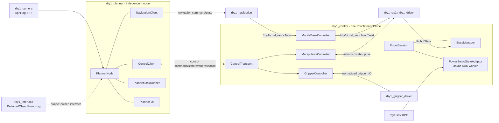

# RBY1 Project Architecture

## Runtime structure



## Package ownership

```text
rby1_project/
├── rby1_interface/          project-specific ROS messages
├── rby1_control/            single robot-facing control node
│   └── rby1_control/
│       ├── control_node.py
│       ├── control_transport.py
│       ├── state_manager.py
│       ├── robot_session.py
│       ├── power_servo_state_adaptor.py
│       ├── mobile_base_controller.py
│       ├── manipulator_controller.py
│       └── gripper_controller.py
├── rby1_navigation/         odometry controller; cmd_raw producer only
├── rby1_planner/            planner-owned client, task runner, and UI
├── rby1_camera/             perception and camera transforms
├── rby1_bringup/            hardware/sensor launch
└── robot_hardware/          hardware-specific drivers
```

Removed packages: `rby1_control_ui`, `rby1_state_monitor`.

## Command and state rules

1. `rby1_navigation` and any future base policy publish raw `Twist` to
   `/rby1/cmd_raw`.
2. `MobileBaseController` applies freshness and robot-safety checks.
3. Only `RBY1ControlNode` publishes the final `/rby1/cmd_vel`.
4. The planner controls stream lifetime over the control protocol; navigation
   has no driver-service dependency.
5. Driver `RobotState` and SDK power/servo samples meet in `StateManager`.
6. Project-specific interfaces belong to `rby1_interface`; the upstream
   `rby1-ros2` working tree remains unmodified.

`DetectedObjectPose` is retained as the project-owned direct-pose interface.
The current production camera path uses `AprilTagDetectionArray` plus TF, so no
runtime publisher/subscriber is forced onto the compatibility message.

## Impedance control

`JointImpedance(stiffness, damping_ratio, torque_limit, hold_time)` is the
only impedance type. Where it is accepted and what the backend sends:

| Where | Backend goal | Completion |
| --- | --- | --- |
| Joint builders (`joint_absolute`, `joint_relative`, `joint_absolute_multi`, `whole_body_joint_absolute`) with `impedance=` | `JointCommand.use_impedance` on the authored joint target | trajectory end + `hold_time` |
| Contact helpers (`press`, `grasp`, `place_on_surface`, `camera_press`, `camera_grasp`, `camera_place_on_surface`) with `impedance=` | the TCP target is solved on the SDK arm model (`arm_kinematics.py`, torso fixed) and sent as `JointCommand.use_impedance` on the solved joint target | trajectory end + `hold_time` |
| Joint tab, `Control: Impedance` (arms only) | same two paths for Joint Space and Cartesian Space jogs / MOVE | same |

Plain `linear_*` and `camera_linear_*` builders stay position-controlled; the
driver's Cartesian impedance builder (a spring to the target pose with no
trajectory) is never used.

Rules enforced along the pipeline:

- `control_commands.py` / `command_model.py` validate ranges, bind stiffness
  vectors to the commanded group and require a Cartesian step's impedance to
  be bound to its arm (`right_arm` / `left_arm`). `Task.build()` requires every
  arm that ran a Cartesian contact step to end the Task with a later
  position-controlled step (`check_impedance_exit`); the helpers append that
  retreat themselves.
- The wire format carries one optional `impedance` object (`type: joint`,
  now with `hold_time`) on Task commands and on the manual commands
  (`jog_joint`, `move_joint_group`, `jog_cartesian`, `move_cartesian`), plus a
  `control_mode` field (`idle`, `position`, `impedance_joint`,
  `impedance_cartesian`, `reanchor`) in the backend state.
- For a Cartesian impedance target `RBY1ControlNode` checks, before anything
  moves: IK model loaded, fresh torso and arm JointState, distance from the
  measured TCP pose within `cartesian_impedance_max_translation_m` /
  `_rotation_deg`, IK convergence (stream-path tolerances), the solved target
  inside the CS soft limits (`cartesian_joint_limit_margin_deg`) and the hard
  joint limits. The runtime CS soft-limit guard also watches these joint
  goals. A rejection fails the step with the reason; nothing is sent.
- After any impedance goal ends, successfully or cancelled, the node sends a
  position goal to the measured joint state (re-anchor) before reporting the
  result; the log shows the original target, the joint state before the
  impedance goal and the re-anchored target, then idle. A cancelled goal is
  still reported as failed after the re-anchor.
- Every manipulation goal has a watchdog: a goal still active after
  `expected_duration * motion_goal_timeout_scale + motion_goal_timeout_margin_sec`
  is cancelled with an error event (the driver itself waits without timeout).

## Supporting changes outside the six requested package operations

The following supporting files were changed because the requested runtime
graph would otherwise be inconsistent:

- `run_planner_ui.sh`: removed the deleted monitor process and passes the SDK
  robot address/model to the control launch;
- package manifests, setup files, launch/config files: updated executables and
  dependencies after package ownership changed;
- tests and documentation: imports and stream-lifecycle expectations updated
  to the new boundaries.

No unrelated camera, LiDAR, bringup, or hardware-driver behavior was changed
as part of this refactor.
