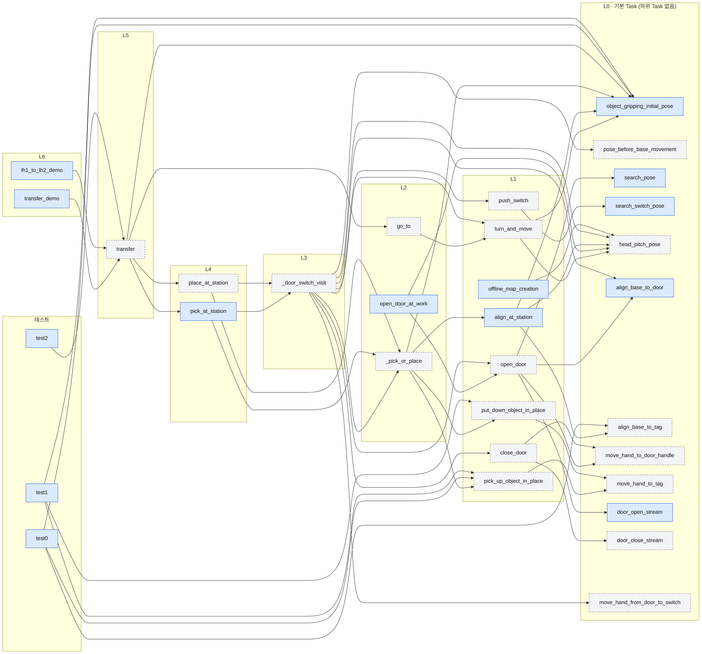
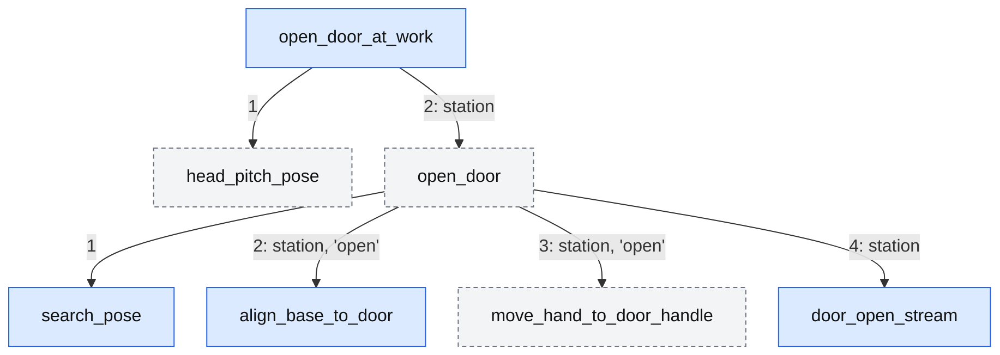

# task.py Task 관계도

> 자동 생성 문서 — 직접 고치지 말 것.
> 원본: `rby1_planner/task.py`. 갱신: `python3 rby1_planner/scripts/gen_task_graph.py`
> (최신 여부 확인: `--check`). Task 별 설명은 [TASKS.md](../TASKS.md).

## 읽는 법

- 화살표 `A --> B` : A 가 B 를 **포함**한다 (`task.extend(B(...))` 또는 `return B(...)`).
- 레벨: 하위 Task 가 없으면 L0, 아니면 1 + 가장 깊은 하위 Task 의 레벨. 왼쪽일수록 상위.
- 시나리오별 그림의 화살표 라벨 = 부모 Task 안에서 몇 번째로 실행되는 하위 Task 인지 (+ 짧은 인자).
- 그림은 원래 크기로 그린다. 화면보다 크면 가로 스크롤.
- 색: 파랑 = `build_tasks()` 에 등록 (Scenario UI 에 보임), 회색 점선 = 다른 Task 안에서만 사용, 빨강 점선 = 어디서도 안 씀 (정리 후보).

## 전체 포함 관계 (개요)

포함 관계가 없는 단독 Task: `ready_pose`, `torso_align`, `door_handle_grasp_pose`, `impedance_demo_joint`, `impedance_demo_press`, `wave_both_arms`, `test_move_base`

## 시나리오별 포함 관계

### transfer_demo

### lh1_to_lh2_demo

```mermaid
%%{init: {"flowchart": {"useMaxWidth": false, "nodeSpacing": 30, "rankSpacing": 50}}}%%
flowchart TD
  lh1_to_lh2_demo["lh1_to_lh2_demo"]
  transfer["transfer"]
  object_gripping_initial_pose["object_gripping_initial_pose"]
  go_to["go_to"]
  pick_at_station["pick_at_station"]
  place_at_station["place_at_station"]
  turn_and_move["turn_and_move"]
  _door_switch_visit["_door_switch_visit"]
  _pick_or_place["_pick_or_place"]
  head_pitch_pose["head_pitch_pose"]
  open_door["open_door"]
  move_hand_from_door_to_switch["move_hand_from_door_to_switch"]
  push_switch["push_switch"]
  pose_before_base_movement["pose_before_base_movement"]
  align_base_to_door["align_base_to_door"]
  close_door["close_door"]
  align_at_station["align_at_station"]
  pick_up_object_in_place["pick_up_object_in_place"]
  put_down_object_in_place["put_down_object_in_place"]
  search_pose["search_pose"]
  move_hand_to_door_handle["move_hand_to_door_handle"]
  door_open_stream["door_open_stream"]
  search_switch_pose["search_switch_pose"]
  door_close_stream["door_close_stream"]
  align_base_to_tag["align_base_to_tag"]
  move_hand_to_tag["move_hand_to_tag"]
  lh1_to_lh2_demo -->|"1: 'LH1_1', 'LH1_2'"| transfer
  transfer -->|"1: side"| object_gripping_initial_pose
  transfer -->|"2: here, source / 4"| go_to
  transfer -->|"3: source"| pick_at_station
  transfer -->|"5: destination"| place_at_station
  go_to -->|"1"| turn_and_move
  pick_at_station -->|"1: station, 'pick'"| _door_switch_visit
  pick_at_station -->|"2: station, 'pick'"| _pick_or_place
  place_at_station -->|"1: station, 'place'"| _door_switch_visit
  place_at_station -->|"2: station, 'place'"| _pick_or_place
  turn_and_move -->|"1"| object_gripping_initial_pose
  turn_and_move -->|"2: head_pitch"| head_pitch_pose
  _door_switch_visit -->|"1: work_pitch / 5: move_pitch / 8: move_pitch / 11: work_pitch"| head_pitch_pose
  _door_switch_visit -->|"2: station"| open_door
  _door_switch_visit -->|"3: station"| move_hand_from_door_to_switch
  _door_switch_visit -->|"4: station / 13: station"| push_switch
  _door_switch_visit -->|"6 / 10"| turn_and_move
  _door_switch_visit -->|"7: station, action"| _pick_or_place
  _door_switch_visit -->|"9: side"| pose_before_base_movement
  _door_switch_visit -->|"12: station, 'close'"| align_base_to_door
  _door_switch_visit -->|"14: station"| close_door
  _pick_or_place -->|"1"| align_at_station
  _pick_or_place -->|"2"| pick_up_object_in_place
  _pick_or_place -->|"3"| put_down_object_in_place
  _pick_or_place -->|"4"| object_gripping_initial_pose
  open_door -->|"1"| search_pose
  open_door -->|"2: station, 'open'"| align_base_to_door
  open_door -->|"3: station, 'open'"| move_hand_to_door_handle
  open_door -->|"4: station"| door_open_stream
  push_switch -->|"1 / 2"| search_switch_pose
  close_door -->|"1: station, 'close'"| move_hand_to_door_handle
  close_door -->|"2: station"| door_close_stream
  align_at_station -->|"1"| object_gripping_initial_pose
  align_at_station -->|"2: head_pitch"| head_pitch_pose
  align_at_station -->|"3"| align_base_to_tag
  pick_up_object_in_place -->|"1"| move_hand_to_tag
  put_down_object_in_place -->|"1"| move_hand_to_tag
  classDef registered fill:#dbeafe,stroke:#2563eb,color:#111;
  classDef internal fill:#f3f4f6,stroke:#6b7280,stroke-dasharray:4 3,color:#111;
  classDef unused fill:#fee2e2,stroke:#dc2626,stroke-dasharray:4 3,color:#111;
  class lh1_to_lh2_demo,object_gripping_initial_pose,pick_at_station,align_base_to_door,align_at_station,search_pose,door_open_stream,search_switch_pose registered;
  class transfer,go_to,place_at_station,turn_and_move,_door_switch_visit,_pick_or_place,head_pitch_pose,open_door,move_hand_from_door_to_switch,push_switch,pose_before_base_movement,close_door,pick_up_object_in_place,put_down_object_in_place,move_hand_to_door_handle,door_close_stream,align_base_to_tag,move_hand_to_tag internal;
```

### open_door_at_work

## 등록 Task 와 함수

| UI 이름 | 함수 | 레벨 | 직접 포함하는 Task |
|---|---|---|---|
| `ready_pose` | [`ready_pose`](../rby1_planner/task.py#L90) | L0 | - |
| `object_gripping_initial_pose` | [`object_gripping_initial_pose`](../rby1_planner/task.py#L133) | L0 | - |
| `object_gripping_initial_pose(front)` | [`object_gripping_initial_pose`](../rby1_planner/task.py#L133) | L0 | - |
| `object_gripping_initial_pose(left)` | [`object_gripping_initial_pose`](../rby1_planner/task.py#L133) | L0 | - |
| `object_gripping_initial_pose(right)` | [`object_gripping_initial_pose`](../rby1_planner/task.py#L133) | L0 | - |
| `search_pose` | [`search_pose`](../rby1_planner/task.py#L191) | L0 | - |
| `search_switch_pose` | [`search_switch_pose`](../rby1_planner/task.py#L200) | L0 | - |
| `door_handle_grasp_pose` | [`door_handle_grasp_pose`](../rby1_planner/task.py#L181) | L0 | - |
| `align_base_to_door(open)` | [`align_base_to_door`](../rby1_planner/task.py#L259) | L0 | - |
| `align_base_to_door(close)` | [`align_base_to_door`](../rby1_planner/task.py#L259) | L0 | - |
| `open_door(ZS)` | [`open_door_at_work`](../rby1_planner/task.py#L506) | L2 | `head_pitch_pose`, `open_door` |
| `door_open_stream` | [`door_open_stream`](../rby1_planner/task.py#L385) | L0 | - |
| `align_at_station(LH1_1)` | [`align_at_station`](../rby1_planner/task.py#L608) | L1 | `object_gripping_initial_pose`, `head_pitch_pose`, `align_base_to_tag` |
| `align_at_station(LH2)` | [`align_at_station`](../rby1_planner/task.py#L608) | L1 | `object_gripping_initial_pose`, `head_pitch_pose`, `align_base_to_tag` |
| `align_at_station(ZS)` | [`align_at_station`](../rby1_planner/task.py#L608) | L1 | `object_gripping_initial_pose`, `head_pitch_pose`, `align_base_to_tag` |
| `pick_at_station(ZS)` | [`pick_at_station`](../rby1_planner/task.py#L700) | L4 | `_door_switch_visit`, `_pick_or_place` |
| `transfer_demo(LH1_1->ZS, LH1_2->LH2)` | [`transfer_demo`](../rby1_planner/task.py#L736) | L6 | `transfer` |
| `lh1_to_lh2_demo(LH1_1->LH1_2)` | [`lh1_to_lh2_demo`](../rby1_planner/task.py#L743) | L6 | `transfer` |
| `impedance_demo_press` | [`impedance_demo_press`](../rby1_planner/task.py#L770) | L0 | - |
| `impedance_demo_joint` | [`impedance_demo_joint`](../rby1_planner/task.py#L749) | L0 | - |
| `wave_both_arms` | [`wave_both_arms`](../rby1_planner/task.py#L788) | L0 | - |
| `offline_map_creation` | [`offline_map_creation`](../rby1_planner/task.py#L836) | L1 | `head_pitch_pose` |
| `test0` | [`test0`](../rby1_planner/task.py#L854) | L2 | `object_gripping_initial_pose`, `align_base_to_tag`, `pick_up_object_in_place` |
| `test1` | [`test1`](../rby1_planner/task.py#L864) | L2 | `object_gripping_initial_pose`, `pick_up_object_in_place`, `put_down_object_in_place` |
| `test2` | [`test2`](../rby1_planner/task.py#L885) | L6 | `transfer` |
| `test_move_base` | [`test_move_base`](../rby1_planner/task.py#L893) | L0 | - |

## 등록 안 된 Task 함수

| 함수 | 레벨 | 사용처 |
|---|---|---|
| [`pose_before_base_movement`](../rby1_planner/task.py#L162) | L0 | `_door_switch_visit` |
| [`head_pitch_pose`](../rby1_planner/task.py#L212) | L0 | `turn_and_move`, `open_door_at_work`, `align_at_station`, `_door_switch_visit`, `offline_map_creation` |
| [`turn_and_move`](../rby1_planner/task.py#L226) | L1 | `go_to`, `_door_switch_visit` |
| [`align_base_to_tag`](../rby1_planner/task.py#L280) | L0 | `align_at_station`, `test0` |
| [`move_hand_to_door_handle`](../rby1_planner/task.py#L308) | L0 | `open_door`, `close_door` |
| [`move_hand_to_tag`](../rby1_planner/task.py#L333) | L0 | `pick_up_object_in_place`, `put_down_object_in_place` |
| [`door_close_stream`](../rby1_planner/task.py#L412) | L0 | `close_door` |
| [`pick_up_object_in_place`](../rby1_planner/task.py#L448) | L1 | `_pick_or_place`, `test0`, `test1` |
| [`put_down_object_in_place`](../rby1_planner/task.py#L472) | L1 | `_pick_or_place`, `test1` |
| [`open_door`](../rby1_planner/task.py#L495) | L1 | `open_door_at_work`, `_door_switch_visit` |
| [`push_switch`](../rby1_planner/task.py#L517) | L1 | `_door_switch_visit` |
| [`move_hand_from_door_to_switch`](../rby1_planner/task.py#L553) | L0 | `_door_switch_visit` |
| [`close_door`](../rby1_planner/task.py#L568) | L1 | `_door_switch_visit` |
| [`go_to`](../rby1_planner/task.py#L601) | L2 | `transfer` |
| [`_pick_or_place`](../rby1_planner/task.py#L630) | L2 | `_door_switch_visit`, `pick_at_station`, `place_at_station` |
| [`_door_switch_visit`](../rby1_planner/task.py#L646) | L3 | `pick_at_station`, `place_at_station` |
| [`place_at_station`](../rby1_planner/task.py#L706) | L4 | `transfer` |
| [`transfer`](../rby1_planner/task.py#L715) | L5 | `transfer_demo`, `lh1_to_lh2_demo`, `test2` |
| [`torso_align`](../rby1_planner/task.py#L115) | L0 | **없음** |

## 실행 순서 (조합 Task 펼침)

등록 Task 중 하위 Task 를 포함하는 것만. **굵게** = 하위 Task, `코드` = 기본 명령 (`task.<method>`). L0 Task 는 펼치지 않는다 (내용은 task.py / TASKS.md).
_(조건부)_ / _(반복)_ 은 if / for 안의 단계, ↑ 는 같은 트리에서 이미 펼친 Task.

<b>transfer_demo</b> (L6) — LH1_1 -> ZS 운반 뒤 ZS 에서 LH1_2 로 돌아와 LH1_2 -> LH2 운반 (왼팔). 로봇은 LH1_1 에서 시작한다.

- **transfer**`('LH1_1', 'ZS')`
  - **object_gripping_initial_pose**`(side)`
  - **go_to**`(here, source)`
    - **turn_and_move**`(_entry_point(from_station), _entry_point(to_sta…)` _(조건부)_
      - **object_gripping_initial_pose**`(side, head_pitch_deg=head_pitch)` _(조건부)_
      - **head_pitch_pose**`(head_pitch)` _(조건부)_
      - `move_to(end_x - start_x, end_y - start_y, 0.0, timeout_…)`
  - **pick_at_station**`(source)`
    - **_door_switch_visit**`(station, 'pick')` _(조건부)_
      - **head_pitch_pose**`(work_pitch)`
      - **open_door**`(station)`
        - `open_gripper('right')`
        - **search_pose**`()`
        - **align_base_to_door**`(station, 'open')`
        - **move_hand_to_door_handle**`(station, 'open')`
        - `close_gripper('right')`
        - **door_open_stream**`(station)`
      - **move_hand_from_door_to_switch**`(station)`
      - **push_switch**`(station)`
        - **search_switch_pose**`()`
        - `close_gripper(SWITCH_DOOR_GRIPPER)`
        - `camera_linear_absolute(SWITCH_DOOR_ARM, switch['tag'], motion, detecti…)` _(반복)_
        - **search_switch_pose**`()`
      - `linear_relative(SWITCH_DOOR_ARM, _wall_move(station, (0.0, 0.0,…)`
      - **head_pitch_pose**`(move_pitch)`
      - **turn_and_move**`(start, end, move_head=False, current_side=side)` _(반복)_ ↑ 위에서 펼침
      - **_pick_or_place**`(station, action)`
        - **align_at_station**`(station, set_torso=False)`
          - **object_gripping_initial_pose**`(side, head_pitch_deg=head_pitch)` _(조건부)_
          - **head_pitch_pose**`(head_pitch)` _(조건부)_
          - **align_base_to_tag**`(_load_location_tag_id(ref), arm=TRANSFER_ARM)`
        - **pick_up_object_in_place**`(tag, arm=TRANSFER_ARM)` _(조건부)_
          - `open_gripper(gripper)`
          - **move_hand_to_tag**`(object_id, approach_offset, contact_offset, app…)`
          - `close_gripper(gripper)`
          - `linear_relative(arm, (0.0, 0.0, lift_m, 0.0, 0.0, 0.0), lift_mo…)`
        - **put_down_object_in_place**`(tag, arm=TRANSFER_ARM)` _(조건부)_
          - **move_hand_to_tag**`(object_id, approach_offset, contact_offset, app…)`
          - `open_gripper(gripper)`
          - `linear_relative(arm, (0.0, 0.0, lift_m, 0.0, 0.0, 0.0), lift_mo…)`
        - **object_gripping_initial_pose**`()`
      - **head_pitch_pose**`(move_pitch)`
      - **pose_before_base_movement**`(side)` _(조건부)_
      - **turn_and_move**`(start, end, move_head=False, current_side=side)` _(반복)_ ↑ 위에서 펼침
      - **head_pitch_pose**`(work_pitch)`
      - **align_base_to_door**`(station, 'close')`
      - **push_switch**`(station)` ↑ 위에서 펼침
      - **close_door**`(station)`
        - `linear_relative(SWITCH_DOOR_ARM, _wall_move(station, (0.0, 0.0,…)`
        - `linear_relative(SWITCH_DOOR_ARM, _wall_move(station, (-0.15, 0.…)`
        - `open_gripper(SWITCH_DOOR_GRIPPER)`
        - **move_hand_to_door_handle**`(station, 'close')`
        - `close_gripper(SWITCH_DOOR_GRIPPER)`
        - **door_close_stream**`(station)`
        - `open_gripper(SWITCH_DOOR_GRIPPER)`
        - `linear_relative(SWITCH_DOOR_ARM, _wall_move(station, (0.0, 0.0,…)`
    - **_pick_or_place**`(station, 'pick')` ↑ 위에서 펼침
  - **go_to**`(source, destination)` ↑ 위에서 펼침
  - **place_at_station**`(destination)`
    - **_door_switch_visit**`(station, 'place')` _(조건부)_ ↑ 위에서 펼침
    - **_pick_or_place**`(station, 'place')` ↑ 위에서 펼침
- **transfer**`('LH1_2', 'LH2', start='ZS')` ↑ 위에서 펼침

<b>lh1_to_lh2_demo</b> (L6) — LH1_1 에서 plate 를 집어 LH1_2 로 이동해 놓는다 (왼팔). 로봇은 LH1_1 에서 시작한다.

- **transfer**`('LH1_1', 'LH1_2')`
  - **object_gripping_initial_pose**`(side)`
  - **go_to**`(here, source)`
    - **turn_and_move**`(_entry_point(from_station), _entry_point(to_sta…)` _(조건부)_
      - **object_gripping_initial_pose**`(side, head_pitch_deg=head_pitch)` _(조건부)_
      - **head_pitch_pose**`(head_pitch)` _(조건부)_
      - `move_to(end_x - start_x, end_y - start_y, 0.0, timeout_…)`
  - **pick_at_station**`(source)`
    - **_door_switch_visit**`(station, 'pick')` _(조건부)_
      - **head_pitch_pose**`(work_pitch)`
      - **open_door**`(station)`
        - `open_gripper('right')`
        - **search_pose**`()`
        - **align_base_to_door**`(station, 'open')`
        - **move_hand_to_door_handle**`(station, 'open')`
        - `close_gripper('right')`
        - **door_open_stream**`(station)`
      - **move_hand_from_door_to_switch**`(station)`
      - **push_switch**`(station)`
        - **search_switch_pose**`()`
        - `close_gripper(SWITCH_DOOR_GRIPPER)`
        - `camera_linear_absolute(SWITCH_DOOR_ARM, switch['tag'], motion, detecti…)` _(반복)_
        - **search_switch_pose**`()`
      - `linear_relative(SWITCH_DOOR_ARM, _wall_move(station, (0.0, 0.0,…)`
      - **head_pitch_pose**`(move_pitch)`
      - **turn_and_move**`(start, end, move_head=False, current_side=side)` _(반복)_ ↑ 위에서 펼침
      - **_pick_or_place**`(station, action)`
        - **align_at_station**`(station, set_torso=False)`
          - **object_gripping_initial_pose**`(side, head_pitch_deg=head_pitch)` _(조건부)_
          - **head_pitch_pose**`(head_pitch)` _(조건부)_
          - **align_base_to_tag**`(_load_location_tag_id(ref), arm=TRANSFER_ARM)`
        - **pick_up_object_in_place**`(tag, arm=TRANSFER_ARM)` _(조건부)_
          - `open_gripper(gripper)`
          - **move_hand_to_tag**`(object_id, approach_offset, contact_offset, app…)`
          - `close_gripper(gripper)`
          - `linear_relative(arm, (0.0, 0.0, lift_m, 0.0, 0.0, 0.0), lift_mo…)`
        - **put_down_object_in_place**`(tag, arm=TRANSFER_ARM)` _(조건부)_
          - **move_hand_to_tag**`(object_id, approach_offset, contact_offset, app…)`
          - `open_gripper(gripper)`
          - `linear_relative(arm, (0.0, 0.0, lift_m, 0.0, 0.0, 0.0), lift_mo…)`
        - **object_gripping_initial_pose**`()`
      - **head_pitch_pose**`(move_pitch)`
      - **pose_before_base_movement**`(side)` _(조건부)_
      - **turn_and_move**`(start, end, move_head=False, current_side=side)` _(반복)_ ↑ 위에서 펼침
      - **head_pitch_pose**`(work_pitch)`
      - **align_base_to_door**`(station, 'close')`
      - **push_switch**`(station)` ↑ 위에서 펼침
      - **close_door**`(station)`
        - `linear_relative(SWITCH_DOOR_ARM, _wall_move(station, (0.0, 0.0,…)`
        - `linear_relative(SWITCH_DOOR_ARM, _wall_move(station, (-0.15, 0.…)`
        - `open_gripper(SWITCH_DOOR_GRIPPER)`
        - **move_hand_to_door_handle**`(station, 'close')`
        - `close_gripper(SWITCH_DOOR_GRIPPER)`
        - **door_close_stream**`(station)`
        - `open_gripper(SWITCH_DOOR_GRIPPER)`
        - `linear_relative(SWITCH_DOOR_ARM, _wall_move(station, (0.0, 0.0,…)`
    - **_pick_or_place**`(station, 'pick')` ↑ 위에서 펼침
  - **go_to**`(source, destination)` ↑ 위에서 펼침
  - **place_at_station**`(destination)`
    - **_door_switch_visit**`(station, 'place')` _(조건부)_ ↑ 위에서 펼침
    - **_pick_or_place**`(station, 'place')` ↑ 위에서 펼침

<b>test2</b> (L6) — LH1_1 -> LH2 -> LH1_1 왕복 픽앤플레이스 1회 (왼팔).

- **transfer**`('LH1_1', 'LH2')`
  - **object_gripping_initial_pose**`(side)`
  - **go_to**`(here, source)`
    - **turn_and_move**`(_entry_point(from_station), _entry_point(to_sta…)` _(조건부)_
      - **object_gripping_initial_pose**`(side, head_pitch_deg=head_pitch)` _(조건부)_
      - **head_pitch_pose**`(head_pitch)` _(조건부)_
      - `move_to(end_x - start_x, end_y - start_y, 0.0, timeout_…)`
  - **pick_at_station**`(source)`
    - **_door_switch_visit**`(station, 'pick')` _(조건부)_
      - **head_pitch_pose**`(work_pitch)`
      - **open_door**`(station)`
        - `open_gripper('right')`
        - **search_pose**`()`
        - **align_base_to_door**`(station, 'open')`
        - **move_hand_to_door_handle**`(station, 'open')`
        - `close_gripper('right')`
        - **door_open_stream**`(station)`
      - **move_hand_from_door_to_switch**`(station)`
      - **push_switch**`(station)`
        - **search_switch_pose**`()`
        - `close_gripper(SWITCH_DOOR_GRIPPER)`
        - `camera_linear_absolute(SWITCH_DOOR_ARM, switch['tag'], motion, detecti…)` _(반복)_
        - **search_switch_pose**`()`
      - `linear_relative(SWITCH_DOOR_ARM, _wall_move(station, (0.0, 0.0,…)`
      - **head_pitch_pose**`(move_pitch)`
      - **turn_and_move**`(start, end, move_head=False, current_side=side)` _(반복)_ ↑ 위에서 펼침
      - **_pick_or_place**`(station, action)`
        - **align_at_station**`(station, set_torso=False)`
          - **object_gripping_initial_pose**`(side, head_pitch_deg=head_pitch)` _(조건부)_
          - **head_pitch_pose**`(head_pitch)` _(조건부)_
          - **align_base_to_tag**`(_load_location_tag_id(ref), arm=TRANSFER_ARM)`
        - **pick_up_object_in_place**`(tag, arm=TRANSFER_ARM)` _(조건부)_
          - `open_gripper(gripper)`
          - **move_hand_to_tag**`(object_id, approach_offset, contact_offset, app…)`
          - `close_gripper(gripper)`
          - `linear_relative(arm, (0.0, 0.0, lift_m, 0.0, 0.0, 0.0), lift_mo…)`
        - **put_down_object_in_place**`(tag, arm=TRANSFER_ARM)` _(조건부)_
          - **move_hand_to_tag**`(object_id, approach_offset, contact_offset, app…)`
          - `open_gripper(gripper)`
          - `linear_relative(arm, (0.0, 0.0, lift_m, 0.0, 0.0, 0.0), lift_mo…)`
        - **object_gripping_initial_pose**`()`
      - **head_pitch_pose**`(move_pitch)`
      - **pose_before_base_movement**`(side)` _(조건부)_
      - **turn_and_move**`(start, end, move_head=False, current_side=side)` _(반복)_ ↑ 위에서 펼침
      - **head_pitch_pose**`(work_pitch)`
      - **align_base_to_door**`(station, 'close')`
      - **push_switch**`(station)` ↑ 위에서 펼침
      - **close_door**`(station)`
        - `linear_relative(SWITCH_DOOR_ARM, _wall_move(station, (0.0, 0.0,…)`
        - `linear_relative(SWITCH_DOOR_ARM, _wall_move(station, (-0.15, 0.…)`
        - `open_gripper(SWITCH_DOOR_GRIPPER)`
        - **move_hand_to_door_handle**`(station, 'close')`
        - `close_gripper(SWITCH_DOOR_GRIPPER)`
        - **door_close_stream**`(station)`
        - `open_gripper(SWITCH_DOOR_GRIPPER)`
        - `linear_relative(SWITCH_DOOR_ARM, _wall_move(station, (0.0, 0.0,…)`
    - **_pick_or_place**`(station, 'pick')` ↑ 위에서 펼침
  - **go_to**`(source, destination)` ↑ 위에서 펼침
  - **place_at_station**`(destination)`
    - **_door_switch_visit**`(station, 'place')` _(조건부)_ ↑ 위에서 펼침
    - **_pick_or_place**`(station, 'place')` ↑ 위에서 펼침
- **transfer**`('LH2', 'LH1_1')` ↑ 위에서 펼침

<b>pick_at_station</b> (L4) — 장비에서 물체를 집는다. 출입 지점에서 시작해 출입 지점에서 끝난다.

- **_door_switch_visit**`(station, 'pick')` _(조건부)_
  - **head_pitch_pose**`(work_pitch)`
  - **open_door**`(station)`
    - `open_gripper('right')`
    - **search_pose**`()`
    - **align_base_to_door**`(station, 'open')`
    - **move_hand_to_door_handle**`(station, 'open')`
    - `close_gripper('right')`
    - **door_open_stream**`(station)`
  - **move_hand_from_door_to_switch**`(station)`
  - **push_switch**`(station)`
    - **search_switch_pose**`()`
    - `close_gripper(SWITCH_DOOR_GRIPPER)`
    - `camera_linear_absolute(SWITCH_DOOR_ARM, switch['tag'], motion, detecti…)` _(반복)_
    - **search_switch_pose**`()`
  - `linear_relative(SWITCH_DOOR_ARM, _wall_move(station, (0.0, 0.0,…)`
  - **head_pitch_pose**`(move_pitch)`
  - **turn_and_move**`(start, end, move_head=False, current_side=side)` _(반복)_
    - **object_gripping_initial_pose**`(side, head_pitch_deg=head_pitch)` _(조건부)_
    - **head_pitch_pose**`(head_pitch)` _(조건부)_
    - `move_to(end_x - start_x, end_y - start_y, 0.0, timeout_…)`
  - **_pick_or_place**`(station, action)`
    - **align_at_station**`(station, set_torso=False)`
      - **object_gripping_initial_pose**`(side, head_pitch_deg=head_pitch)` _(조건부)_
      - **head_pitch_pose**`(head_pitch)` _(조건부)_
      - **align_base_to_tag**`(_load_location_tag_id(ref), arm=TRANSFER_ARM)`
    - **pick_up_object_in_place**`(tag, arm=TRANSFER_ARM)` _(조건부)_
      - `open_gripper(gripper)`
      - **move_hand_to_tag**`(object_id, approach_offset, contact_offset, app…)`
      - `close_gripper(gripper)`
      - `linear_relative(arm, (0.0, 0.0, lift_m, 0.0, 0.0, 0.0), lift_mo…)`
    - **put_down_object_in_place**`(tag, arm=TRANSFER_ARM)` _(조건부)_
      - **move_hand_to_tag**`(object_id, approach_offset, contact_offset, app…)`
      - `open_gripper(gripper)`
      - `linear_relative(arm, (0.0, 0.0, lift_m, 0.0, 0.0, 0.0), lift_mo…)`
    - **object_gripping_initial_pose**`()`
  - **head_pitch_pose**`(move_pitch)`
  - **pose_before_base_movement**`(side)` _(조건부)_
  - **turn_and_move**`(start, end, move_head=False, current_side=side)` _(반복)_ ↑ 위에서 펼침
  - **head_pitch_pose**`(work_pitch)`
  - **align_base_to_door**`(station, 'close')`
  - **push_switch**`(station)` ↑ 위에서 펼침
  - **close_door**`(station)`
    - `linear_relative(SWITCH_DOOR_ARM, _wall_move(station, (0.0, 0.0,…)`
    - `linear_relative(SWITCH_DOOR_ARM, _wall_move(station, (-0.15, 0.…)`
    - `open_gripper(SWITCH_DOOR_GRIPPER)`
    - **move_hand_to_door_handle**`(station, 'close')`
    - `close_gripper(SWITCH_DOOR_GRIPPER)`
    - **door_close_stream**`(station)`
    - `open_gripper(SWITCH_DOOR_GRIPPER)`
    - `linear_relative(SWITCH_DOOR_ARM, _wall_move(station, (0.0, 0.0,…)`
- **_pick_or_place**`(station, 'pick')` ↑ 위에서 펼침

<b>open_door_at_work</b> (L2) — 작업 위치(work)에서 문 열기만 단독 실행한다 (Scenario UI 용).

- **head_pitch_pose**`(_load_point_head_pitch(f'{station}.work'))`
- **open_door**`(station)`
  - `open_gripper('right')`
  - **search_pose**`()`
  - **align_base_to_door**`(station, 'open')`
  - **move_hand_to_door_handle**`(station, 'open')`
  - `close_gripper('right')`
  - **door_open_stream**`(station)`

<b>test0</b> (L2) — 허리 유지. 팔만 초기 자세 -> D435 로 tag_3 보고 base 정렬 -> 왼팔 손목 카메라로 접근·파지·상승 -> 팔 초기 자세.

- **object_gripping_initial_pose**`()`
- **align_base_to_tag**`('tag_3', arm='left_arm')`
- **pick_up_object_in_place**`('tag_3', arm='left_arm')`
  - `open_gripper(gripper)`
  - **move_hand_to_tag**`(object_id, approach_offset, contact_offset, app…)`
  - `close_gripper(gripper)`
  - `linear_relative(arm, (0.0, 0.0, lift_m, 0.0, 0.0, 0.0), lift_mo…)`
- **object_gripping_initial_pose**`()`

<b>test1</b> (L2) — 허리 왼쪽 고정. 왼팔: tag_1 잡기 -> 왼쪽(-x) 15 cm -> tag_2 놓기/다시 잡기 -> 오른쪽(+x) 15 cm -> tag_1 놓기, 10회 반복.

- **object_gripping_initial_pose**`('left')`
- **pick_up_object_in_place**`('tag_1', arm='left_arm')`
  - `open_gripper(gripper)`
  - **move_hand_to_tag**`(object_id, approach_offset, contact_offset, app…)`
  - `close_gripper(gripper)`
  - `linear_relative(arm, (0.0, 0.0, lift_m, 0.0, 0.0, 0.0), lift_mo…)`
- `linear_relative('left_arm', (-0.25, 0.0, 0.0, 0.0, 0.0, 0.0), s…)`
- **put_down_object_in_place**`('tag_2', arm='left_arm')`
  - **move_hand_to_tag**`(object_id, approach_offset, contact_offset, app…)`
  - `open_gripper(gripper)`
  - `linear_relative(arm, (0.0, 0.0, lift_m, 0.0, 0.0, 0.0), lift_mo…)`
- **pick_up_object_in_place**`('tag_2', arm='left_arm')` ↑ 위에서 펼침
- `linear_relative('left_arm', (0.15, 0.0, 0.0, 0.0, 0.0, 0.0), sh…)`
- **put_down_object_in_place**`('tag_1', arm='left_arm')` ↑ 위에서 펼침
- `rewind(runs)`

<b>align_at_station</b> (L1) — 장비의 집기/놓기 지점에서 base 정렬만 한다 (집기/놓기 없음, 왼팔 손목 카메라 기준).

- **object_gripping_initial_pose**`(side, head_pitch_deg=head_pitch)` _(조건부)_
- **head_pitch_pose**`(head_pitch)` _(조건부)_
- **align_base_to_tag**`(_load_location_tag_id(ref), arm=TRANSFER_ARM)`

<b>offline_map_creation</b> (L1) — 운영 전 오프라인 맵 생성. 머리를 이동 각도로 -> cuVSLAM mapping 시작 -> 제자리 보정

- **head_pitch_pose**`(_load_move_head_pitch_deg())`
- `vslam_start('mapping')`
- `vslam_station_correct()`
- `vslam_operator_mapping()`
- `vslam_save_map(map_name)`

